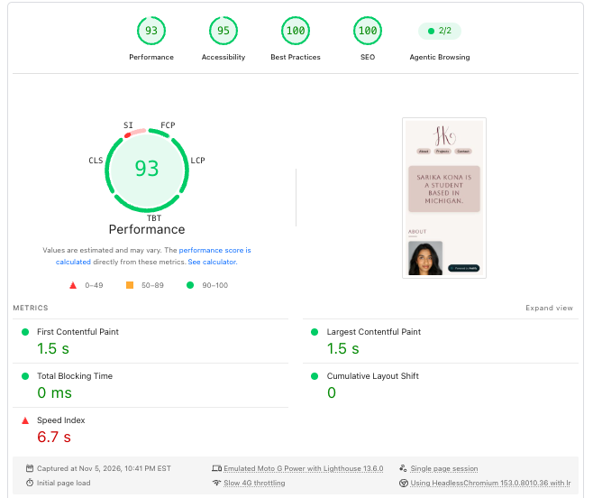
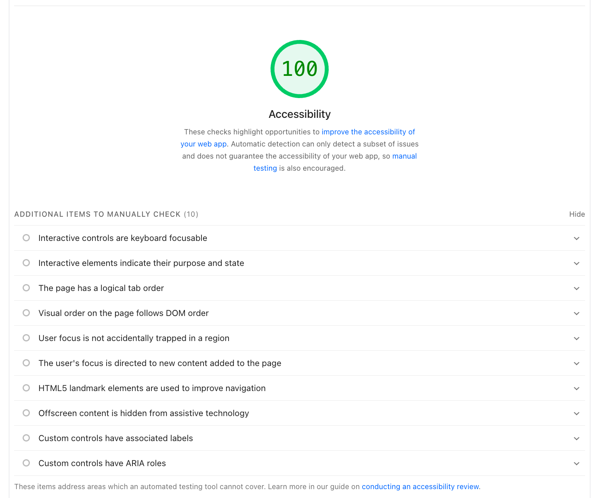

# Portfolio Accessibility Report

## 1. Initial PageSpeed Insights Audit
- **Initial Accessibility Score:** 95 / 100
- **Audit Date:** November 5, 2026

### Identified Issues
- **Color Contrast (WCAG 1.4.3 Minimum Contrast):** Foreground link text (`Michigan State University`, `konasari@msu.edu`) and footer text (`Copyright © 2026 Sarika Kona`) failed to meet the required 4.5:1 contrast ratio against the primary background (`--bg-primary: #F9F4F2`).

## 2. Fixes & Remediation
- **Accent Link & Footer Contrast Fix:** Updated `--accent-main` to `#5C3240` and `--accent-secondary` to `#5E4442` in `style.css`. Darkened text elements to achieve a contrast ratio above 6:1 (exceeding the WCAG AA requirement of 4.5:1).
- **Keyboard Navigation Enhancements (Exceptional Work):**
  - Implemented an accessible "Skip to main content" link at the top of the DOM for screen reader and keyboard users.
  - Configured high-contrast visual focus rings (`:focus-visible { outline: 3px solid #1E0B13; outline-offset: 3px; }`) on all interactive buttons and navigation links.

## 3. Final Verification
- **Final Accessibility Score:** 100 / 100
### Initial Audit (95/100)

### Remediation Audit (100/100)

